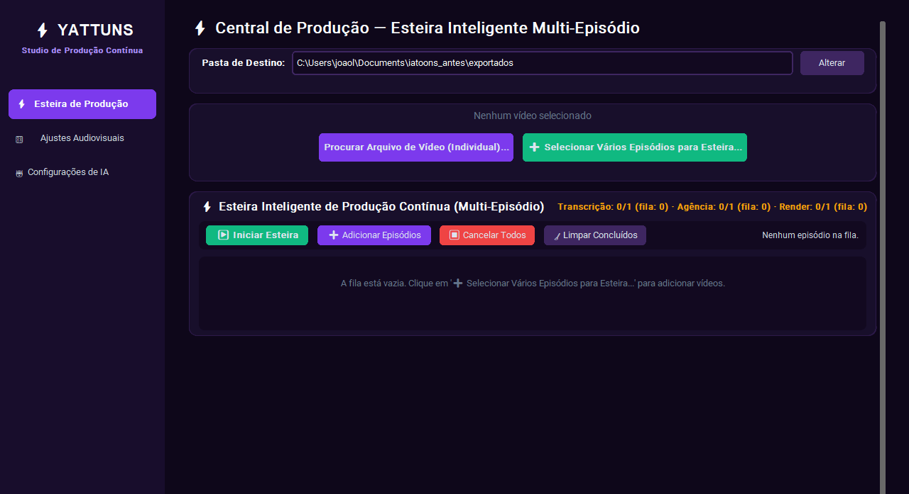
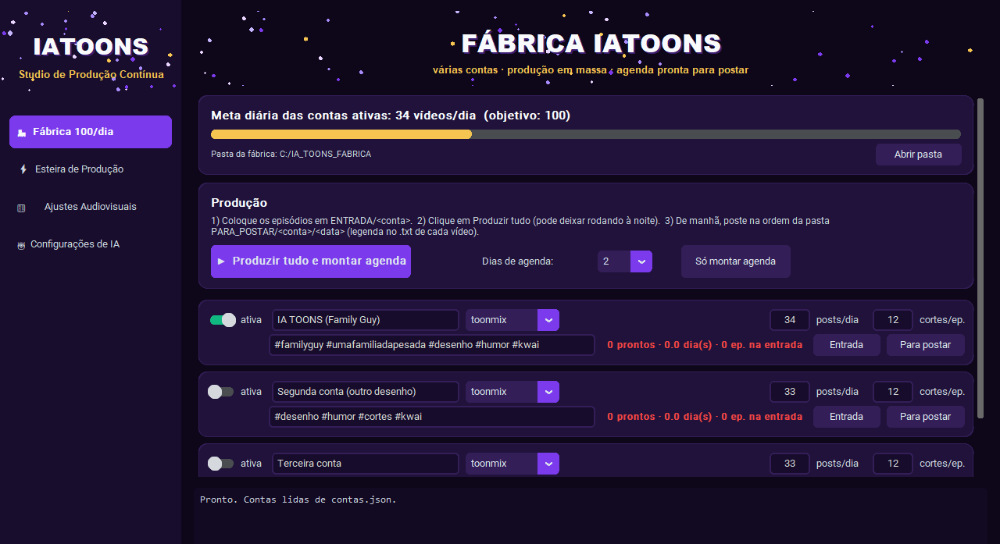
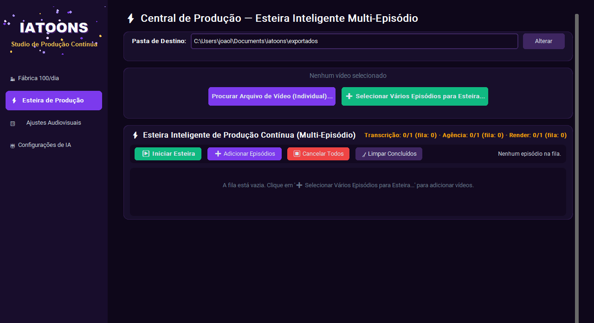
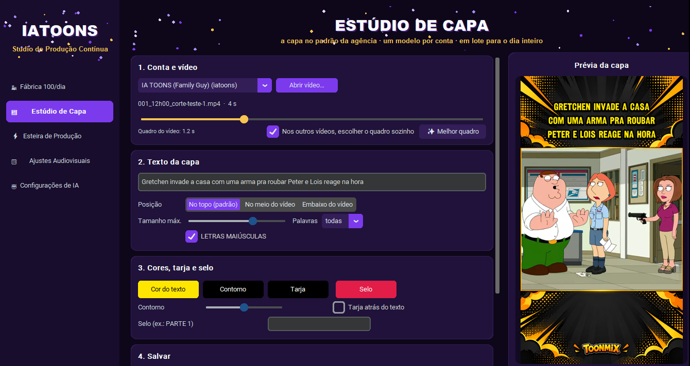
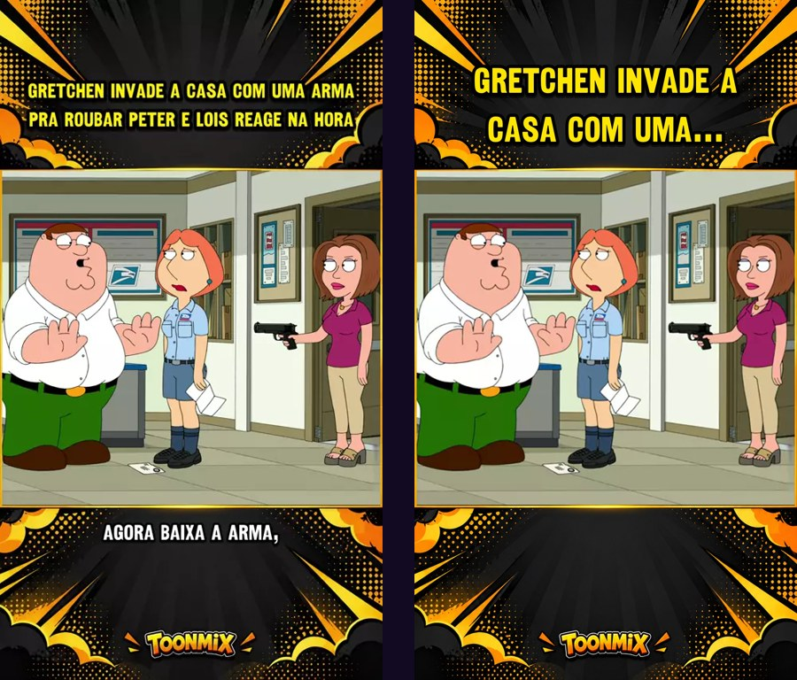
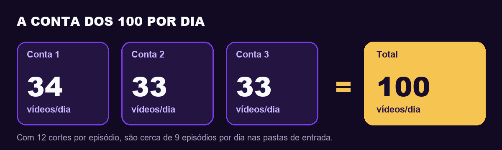

<p align="center">
  
</p>

<p align="center">
  <b>O estúdio de cortes verticais agora é uma fábrica:</b> várias contas, produção em massa e agenda pronta para postar.
</p>

<p align="center">
  
  
  
  
  
</p>

---

## Antes e depois

| Antes | Depois |
|:---:|:---:|
|  |  |
| Uma esteira, uma conta, um episódio de cada vez. O nome aparecia como "YATTUNS". | Aba **Fábrica 100/dia** com todas as contas na mesma tela, meta do dia e um botão que faz tudo. Marca **IATOONS** com partículas. |

A esteira de sempre continua lá, do mesmo jeito que ela já conhece:

<p align="center"></p>

---

## Estúdio de Capa (regra da agência)

A capa é uma das regras da agência, então ela ganhou uma tela só para isso.

<p align="center"></p>

- **Prévia ao vivo:** abre qualquer corte pronto e mostra a capa do jeito que vai ficar.
- **Escolher o quadro:** arrasta a barrinha até a cena certa, ou clica em **✨ Melhor quadro** para o app achar a cena mais forte.
- **Texto do jeito dela:** título inteiro ou encurtado, posição (topo, meio ou embaixo), tamanho, maiúsculas, cor do texto e do contorno, tarja atrás do texto e selo como "PARTE 1".
- **⭐ Salvar como modelo da conta:** a partir daí a Fábrica faz **todas** as capas do dia nesse padrão, sozinha. Cada conta tem o seu.
- **📂 Aplicar numa pasta inteira:** refaz as capas de um dia de postagens de uma vez.
- **Outro desenho ou nicho:** escolhe a imagem de fundo da conta nova e o visual dela fica pronto para a Fábrica e a Esteira.

<p align="center"><br>
<sub>À esquerda, uma capa que está no Kwai hoje; à direita, a mesma cena feita pelo Estúdio de Capa.</sub></p>

---

## A conta dos 100 por dia

<p align="center"></p>

Antes eram uns **30 vídeos por dia** numa conta só. Agora cada conta tem a sua própria meta e a fábrica soma tudo na barra dourada do topo.

---

## Como fica o dia a dia (3 passos)

**1. À noite, colocar os episódios na pasta da conta**

```
C:\IA_TOONS_FABRICA\ENTRADA\<nome-da-conta>\
```

**2. Clicar em "▶ Produzir tudo e montar agenda"** e deixar o PC trabalhando.

**3. De manhã, abrir "Para postar"** e seguir a ordem:

```
PARA_POSTAR\<conta>\<data>\
   001_07h00_titulo-do-corte.mp4        o vídeo, já na ordem e no horário
   001_07h00_titulo-do-corte.txt        a legenda pronta, com hashtags
   001_07h00_titulo-do-corte_capa.jpg   a capa, no modelo da conta
   AGENDA.csv                           a lista do dia, abre no Excel
```

É só copiar a legenda do `.txt`, subir o vídeo e seguir para o próximo.

---

## O que a fábrica cuida sozinha

| | |
|---|---|
| 🔁 **Nunca repete corte** | Cada corte postado fica registrado. Na próxima agenda ele não volta. |
| 🔀 **Intercala episódios** | Não saem 12 cortes do mesmo episódio em sequência; ela mistura para o feed não cansar. |
| 🕐 **Respeita o horário** | Hoje ela não marca post para um horário que já passou. Amanhã continua de onde parou. |
| 🎨 **Visual por conta** | Cada conta pode ter o seu fundo, cores e nome (`dados/perfis/<conta>.json`). Se não tiver, usa o TOONMIX. |
| ⚡ **Modo rápido** | Por conta, dá para ligar a qualidade "rápida": renderiza de 3 a 4 vezes mais vídeos por hora, para aguentar o volume. |
| 🧩 **Outros desenhos e nichos** | Nada mais preso ao Family Guy: é criar uma conta nova, escolher o perfil e colocar os episódios na pasta dela. |

---

## Linha do tempo

| Quando | O que mudou |
|---|---|
| **Início** | Primeira versão: um corte por vez, escolhendo início e fim na mão. |
| **Esteira inteligente** | Vários episódios em fila, transcrição, a "agência" escolhendo os melhores trechos e títulos, padrão Kwai Cut Toonmix e render mais estável. |
| **Update Jasão (agora)** | Fábrica multi-conta com meta de 100/dia, agenda pronta para postar, **Estúdio de Capa** no padrão da agência, perfis por conta, modo rápido, marca IATOONS com partículas e 14 testes novos. Também corrigimos um erro antigo: a esteira ignorava o perfil escolhido e sempre usava "toonmix". |

---

## Para começar

```bash
pip install -r requirements.txt
python main.py
```

Ou dois cliques em **`FABRICA_RODAR_TUDO.bat`** para produzir e montar a agenda sem abrir a tela.

Na primeira vez, configure a chave da IA na aba **Configurações de IA**. As contas ficam em `contas.json` (tem um modelo em `contas.exemplo.json`).

O manual técnico completo, com todas as funções da esteira, está em **[MANUAL.md](MANUAL.md)**.

---

## Um aviso sincero

Cortes de desenhos como Family Guy são conteúdo de terceiros. O Kwai e as outras redes podem tirar a monetização ou derrubar contas, principalmente quando o volume é alto. Para contas novas, o caminho mais seguro é conteúdo licenciado, próprio ou de domínio público. A fábrica **não posta nada sozinha**: quem decide o que sobe é sempre você.

<p align="center"><sub>Feito com carinho para a fábrica de cortes mais organizada da casa 💜</sub></p>
